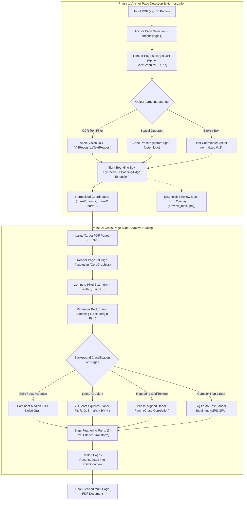

# PDF-Object-Remover (`pdf-object-remover`)

[-lightgrey.svg)](https://apple.com)
[](LICENSE)
[](https://github.com/studiohelioripple/pdf-object-remover)
[](https://swift.org)
[](https://python.org)
[](https://developer.apple.com/metal/)
[](https://developer.apple.com/documentation/vision)

A multi-page PDF presentation, slide deck, and document healing suite for macOS.

Addresses a recurring watermark, badge, counter, stamp, or label on a single **Anchor Page** (via Apple Vision OCR or spatial quadrants), normalizes the bounding area, and **heals all slides/pages at that matching position**, adapting page-by-page to each slide's individual background color, 2D gradient, grain noise, or drafting grid.

---

## 🎯 The Core Problem & Solution

When cleaning multi-page PDFs (such as keynote presentations, client decks, architectural blueprints, or scanned reports), users face a recurring challenge:

> **A watermark, draft label, stamp, or disclaimer recurs at the exact same screen position across 50+ slides, but the background underneath varies wildly from page to page.**
>
> - *Slide 1* might be a dark hero slide with a subtle diagonal gradient.
> - *Slide 2* might be warm drafting paper with high-frequency paper grain.
> - *Slide 3* might be an architectural structural grid or blueprint line drawing.

Blindly pasting a solid white box or generic rectangle destroys dark slides and ruins textured drawings. Conversely, manually selecting coordinates on every single slide is impossibly slow.

**`pdf-object-remover` solves this with a two-phase architecture**:
1. **Targeting on Anchor Page**: Locate the object once on an anchor slide (by OCR text matching, quadrant zone, or coordinates) and extract resolution-independent normalized bounds `(normX, normY, normW, normH)`.
2. **Slide-Adaptive In-Place Healing**: Scale the target bounding box across all pages, sampling local boundary pixels on **each individual slide** to synthesize matching 2D gradients, grain noise, flat fills, or phase-aligned donor grid patches.

---

## 🏗️ System Architecture



---

## ✨ Key Capabilities

- 🎯 **Anchor Page Addressing**:
  - **OCR Text Filter / Query**: `--filter "CONFIDENTIAL"` or `--query "DRAFT"` automatically finds and bounds the text using Apple Vision.
  - **Spatial Quadrant Presets**: `--zone bottom-right`, `bottom-right-corner`, `footer`, `header`, `logo`, `bottom-left`, `top-right`, `top-left`, `all`, or `custom`.
  - **Explicit Bounding Box**: `--box "x,y,w,h"` (supports either normalized `0.0..1.0` or pixel coordinates).
- 📐 **Resolution-Independent Normalization**: Normalized coordinate mapping ensures flawless alignment across mixed aspect ratios (e.g., landscape slides alongside portrait appendices).
- 🎨 **Page-Adaptive Healing Strategies (from `keynote-tools`)**:
  - **`auto`** *(Default)*: Automatically measures local perimeter variance on each page. Applies 2D planar gradient equations if variance is high, or solid median fill if flat, plus synthetic noise grain.
  - **`gradient`**: Samples a 14px boundary ring and solves 2D least-squares plane equations ($R, G, B = ax + by + c$) + MAD (Median Absolute Deviation) noise estimation.
  - **`solid`**: Rapid dominant color fill with distance-transform edge feathering.
  - **`exemplar`**: 2D normalized cross-correlation (`cv2.matchTemplate`) donor patch transfer for architectural drafting paper, blueprint grids, and repeating dot matrices.
  - **`lama` / `composite`**: Big-LaMa neural inpainting running on Apple Silicon GPU (`mps`) with a 6px perimeter seam feathering ramp.
- 📸 **Diagnostic Visual Verification**:
  - `--inspect`: Prints the exact normalized and pixel coordinates along with recognized text without modifying the PDF.
  - `--preview-mask mask.png`: Saves an image of the anchor page with the detected bounding box highlighted in semi-transparent red with a green border.
- ⚡ **Native Apple Silicon Speed**: Built with Swift, `PDFKit`, `CoreGraphics`, `Vision`, and `CoreImage` for sub-second vector rendering and PDF reconstruction.

---

## 🛠️ Tools & Executables

Installed in `~/.local/bin` and `~/bin`:

| Command | Type | Description |
|---|---|---|
| [`pdf-object-remover`](scripts/pdf_object_remover.py) | Python CLI | Master CLI orchestrator handling detection, preview masks, and dispatching. |
| `pdf-remover` | Alias | Quick command alias for `pdf-object-remover`. |
| [`pdf_healer`](scripts/pdf_healer) | Native Binary | Compiled Swift executable (`CoreGraphics`, `Vision`, `CoreImage`, `PDFKit`). |
| [`exemplar_healer.py`](scripts/exemplar_healer.py) | Python 3 | 2D cross-correlation donor patch matcher and Big-LaMa neural seam healer. |
| [`build.sh`](scripts/build.sh) | Shell Script | Native compiler script using `swiftc -O`. |

---

## 🚀 Installation

### Option 1: Install as Antigravity / Gemini AI Agent Skill (Recommended)

To install this skill for AI agent pairing in Antigravity or Gemini CLI:

```bash
# Clone directly into your skills directory
git clone https://github.com/studiohelioripple/pdf-object-remover.git ~/.gemini/config/skills/pdf-object-remover

# Run automated installer (compiles native engine & creates CLI links)
cd ~/.gemini/config/skills/pdf-object-remover
./install.sh
```

The agent will automatically discover `pdf-object-remover` and its `SKILL.md` specification.

### Option 2: Standalone CLI Tool

```bash
# 1. Clone repository
git clone https://github.com/studiohelioripple/pdf-object-remover.git
cd pdf-object-remover

# 2. Install Python dependencies
pip install -r requirements.txt

# 3. Build native Apple Silicon engine & link commands to ~/.local/bin
./install.sh
```

Make sure `~/.local/bin` (or `~/bin`) is in your shell's `$PATH`.

### Prerequisites
- macOS 13+ (Ventura, Sonoma, Sequoia - Apple Silicon M1/M2/M3/M4 or Intel)
- Xcode Command Line Tools (`swiftc`): `xcode-select --install`
- Python 3.9+ with `pip`

---

## 📖 Practical Usage Recipes

### 1. Non-Destructive Inspection & Diagnostic Mask Preview
Verify exactly what object will be removed before touching your presentation:
```bash
pdf-object-remover \
  --input presentation.pdf \
  --anchor-page 1 \
  --filter "CONFIDENTIAL" \
  --preview-mask preview_mask.png \
  --inspect
```

Output:
```
🎯 Anchor Page 1 Object Detection Summary:
  • Normalized Area: [x: 0.7635, y: 0.9078, w: 0.1619, h: 0.0296]
  • Pixel Area (300 DPI): 3054,2042 647x66 px
  • Matched Text: CONFIDENTIAL DRAFT
  • Background: #1F388C (Gradient: False)
  • Preview Mask: preview_mask.png
```

---

### 2. Auto-Adaptive Cross-Slide Watermark Erase
Detects `"DRAFT"` on Page 1 and heals all slides, automatically adapting to each slide's individual color/gradient:
```bash
pdf-object-remover \
  --input presentation.pdf \
  --output presentation_clean.pdf \
  --anchor-page 1 \
  --filter "DRAFT" \
  --padding 6 \
  --mode auto
```

---

### 3. Corner Stamp or Logo Removal (Flush to Page Boundary)
Removes a corner stamp and extends flush to the canvas edge to avoid hairline remnants:
```bash
pdf-object-remover \
  --input document.pdf \
  --output document_clean.pdf \
  --anchor-page 1 \
  --zone bottom-right-corner \
  --extend-right \
  --extend-bottom \
  --feather 5
```

---

### 4. Remove Header or Footer Notice Bar Across All Slides
Erases a full-width footer disclaimer across the entire presentation:
```bash
pdf-object-remover \
  --input pitch_deck.pdf \
  --output pitch_deck_clean.pdf \
  --anchor-page 1 \
  --zone footer \
  --mode gradient
```

---

### 5. Architectural Blueprint / Grid Slide Healing (`exemplar`)
For blueprint sets, structural drawings, or drafting paper slides where removing a watermark requires matching repeating grid lines:
```bash
pdf-object-remover \
  --input blueprints.pdf \
  --output blueprints_clean.pdf \
  --anchor-page 1 \
  --filter "PRELIMINARY DRAFT" \
  --mode exemplar \
  --feather 6
```

---

### 6. Selective Page Range Processing
Heal only slides 2 through 15, leaving the title slide untouched:
```bash
pdf-object-remover \
  --input deck.pdf \
  --output deck_clean.pdf \
  --anchor-page 2 \
  --filter "INTERNAL ONLY" \
  --pages "2-15"
```

---

## ⚙️ CLI Flag Reference

| Flag | Shortcut | Default | Description |
|---|---|---|---|
| `--input` | `-i` | *Required* | Path to input PDF document |
| `--output` | `-o` | *Required* (unless `--inspect`) | Path to output cleaned PDF document |
| `--anchor-page` | `-p` | `1` | Reference page (1-based index) to detect target object on |
| `--filter` / `--query` | `-f` / `-q` | `None` | Case-insensitive OCR text query/substring to detect via Apple Vision |
| `--zone` | `-z` | `bottom-right` | Spatial search zone: `bottom-right`, `bottom-right-corner`, `logo`, `bottom-left`, `top-right`, `top-left`, `footer`, `header`, `all`, `custom` |
| `--min-x`, `--max-x` | | `None` | Custom zone horizontal ratio range (`0.0` to `1.0`) |
| `--min-y`, `--max-y` | | `None` | Custom zone vertical ratio range (`0.0` to `1.0`) |
| `--box` | `-b` | `None` | Explicit bounding box: `"x,y,w,h"` (normalized `0..1` or pixel coords) |
| `--mode` | `-m` | `auto` | Healing mode: `auto`, `gradient`, `solid`, `exemplar`, `lama`, `composite` |
| `--dpi` | | `300.0` | PDF page rendering resolution DPI (default: `300`) |
| `--pages` | | `all` | Target pages to heal (`all`, `1-10`, `2,4,6`) |
| `--exclude-pages`| | `""` | Pages to exempt from healing |
| `--padding` | | `4` | Pixel padding expansion around detected object bounds |
| `--feather` | | `4` | Perimeter edge feathering ramp width in pixels |
| `--extend-right`| | `false` | Extend mask box flush to right page boundary |
| `--extend-bottom`| | `false` | Extend mask box flush to bottom page boundary |
| `--preview-mask`| | `None` | Path to save diagnostic highlighted preview image |
| `--inspect` | | `false` | Inspect anchor page and print coordinates without modifying PDF |
| `--json` | | `false` | Output results/stats in structured JSON format |

---

## 🐍 Python API Integration

```python
import sys
from pathlib import Path

# Add skill scripts directory to sys.path
scripts_dir = Path.home() / ".gemini/config/skills/pdf-object-remover/scripts"
if scripts_dir.exists():
    sys.path.append(str(scripts_dir))

from pdf_object_remover import inspect_anchor_page, process_with_native_engine

# 1. Inspect Anchor Page
info = inspect_anchor_page(
    input_pdf="presentation.pdf",
    anchor_page=1,
    text_filter="CONFIDENTIAL",
    dpi=300.0,
    preview_mask_path="preview.png"
)
print("Normalized Box:", info["normalizedBox"])
print("Matched Text:", info["textMatched"])

# 2. Heal across all slides
success = process_with_native_engine(
    input_pdf="presentation.pdf",
    output_pdf="presentation_clean.pdf",
    anchor_page=1,
    text_filter="CONFIDENTIAL",
    mode="auto",
    padding=6,
    feather=4,
    dpi=300.0
)
```

---

## 📚 Technical References

- [`references/ARCHITECTURE.md`](references/ARCHITECTURE.md): Deep-dive into coordinate normalization, 2D planar fitting, and distance-transform mathematics.
- [`references/HEALING_MODES.md`](references/HEALING_MODES.md): Algorithmic comparisons between planar detrending, cross-correlation exemplar donors, and Big-LaMa neural synthesis.
- [`examples/sample_workflow.sh`](examples/sample_workflow.sh): Comprehensive executable shell recipes.
- [`SKILL.md`](SKILL.md): Complete Antigravity agentic skill specification.

---

## 📜 License

Distributed under the [MIT License](LICENSE). Built for macOS by [studiohelioripple](https://github.com/studiohelioripple).
