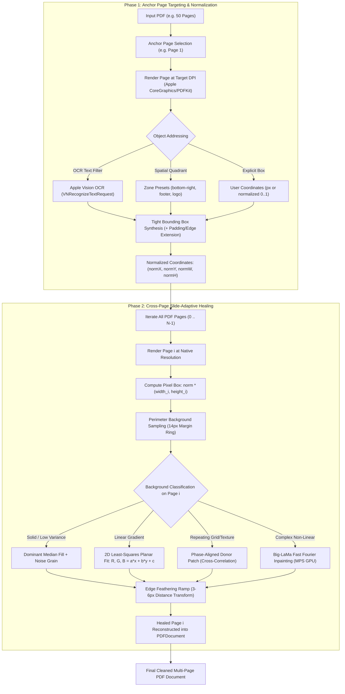

# Architecture: PDF-Object-Remover

## 1. System Overview

`pdf-object-remover` is a specialized macOS document and presentation healing suite designed for multi-page PDF slide decks, architectural blueprints, contracts, and graphical reports.

It addresses a fundamental challenge when cleaning multi-page PDFs:
> **A watermark, badge, counter, stamp, or label recurs at the identical relative screen coordinates across many slides, but the underlying background texture, gradient angle, paper tone, or grid pattern varies significantly from page to page.**

Instead of blindly applying a flat white rectangle across every slide (which ruins dark or textured slides) or requiring tedious manual coordinates on every single page, `pdf-object-remover` implements a **Two-Phase Anchor Detection & Slide-Adaptive Propagation Architecture**:

---

## 2. Anchor Page Detection Pipeline

1. **Rendering & Normalization**:
   - The anchor page is rendered via `PDFKit` and `CoreGraphics` into an in-memory 32-bit RGBA pixel buffer at configurable resolution (default `300 DPI`).
2. **Apple Vision OCR**:
   - Uses `VNRecognizeTextRequest` with `.accurate` recognition level.
   - Text boxes intersecting the designated spatial zone that match the user's `--filter` / `--query` string are merged into a tight union bounding box.
3. **Normalized Relative Coordinates**:
   - The detected bounding box is normalized to floating-point ratios:
     $$\text{norm}_x = \frac{x}{\text{width}}, \quad \text{norm}_y = \frac{y}{\text{height}}, \quad \text{norm}_w = \frac{w}{\text{width}}, \quad \text{norm}_h = \frac{h}{\text{height}}$$
   - This ensures that if subsequent pages have different aspect ratios (e.g. portrait vs. landscape) or varying canvas resolutions, the target box scales accurately.

---

## 3. Page-Adaptive Perimeter Healing Mathematics

Because the background underneath the target coordinates differs per slide, each page executes its own local background analysis:

### 3.1 Perimeter Ring Sampling
A 14-pixel wide perimeter ring surrounding the target rectangle is sampled:
- Top border strip: $[y_1 - 14, y_1] \times [x_1 - 14, x_2 + 14]$
- Bottom border strip: $[y_2, y_2 + 14] \times [x_1 - 14, x_2 + 14]$
- Left border strip: $[y_1, y_2] \times [x_1 - 14, x_1]$
- Right border strip: $[y_1, y_2] \times [x_2, x_2 + 14]$

### 3.2 2D Surface Plane Fitting
For gradient surfaces, the engine solves least-squares planar equations independently for each color channel ($V \in \{R, G, B\}$):
$$V(x, y) = a_v x + b_v y + c_v$$

By minimizing the squared residual sum:
$$S(a, b, c) = \sum_{i=1}^{N} \left(a x_i + b y_i + c - V_i\right)^2$$

The closed-form normal equations are solved in Swift using a $3 \times 3$ determinant matrix.

### 3.3 High-Frequency Film Grain / Paper Noise Estimation
To avoid the "flat plastic rectangle" look, the engine measures the Median Absolute Deviation (MAD) of the residuals:
$$\text{MAD} = \text{median}\left(\left| r_i - \text{median}(r) \right|\right)$$
$$\hat{\sigma} = 1.4826 \times \text{MAD}$$

Uniform random noise matched to $\hat{\sigma}$ is dynamically synthesized into the patch, matching the natural texture or paper grain of the original slide.

### 3.4 Distance-Transform Edge Feathering
A multi-pixel transition ramp ($4\text{ px}$ default) weights the border pixels between original canvas and reconstructed background:
$$\text{weight}(x, y) = \min\left(1.0, \frac{\text{dist\_to\_boundary} + 1.0}{\text{feather\_radius} + 1}\right)$$
$$C_{\text{final}}(x, y) = (1 - w) \cdot C_{\text{orig}}(x, y) + w \cdot C_{\text{recon}}(x, y)$$

This completely eliminates visible edge seams or cut lines.
